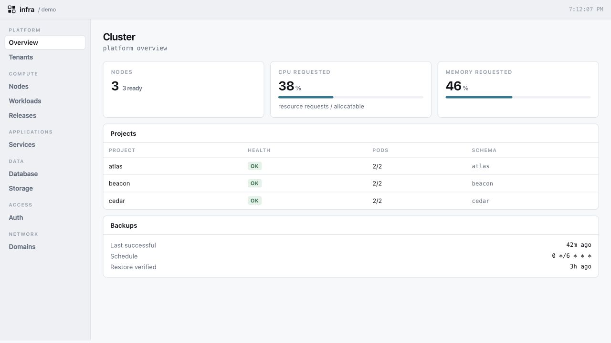
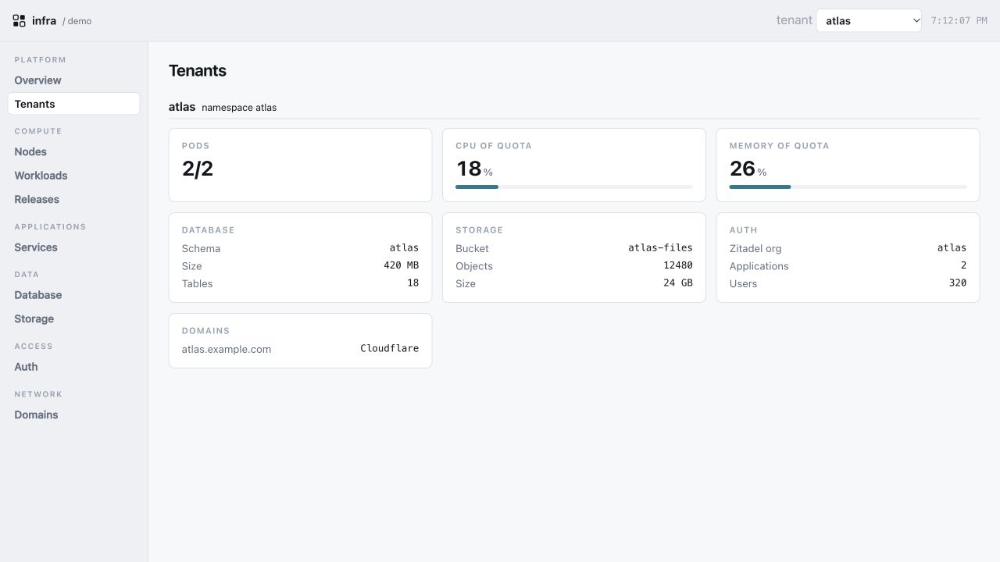

# Idle Infra

**Run your applications on a cluster you own, with the shared services already connected.**

Idle Infra brings Kubernetes, PostgreSQL, login, object storage and operational
visibility together in one OpenTofu framework. Give each application its own
namespace, database schema and deployment permissions. Share the services that
would otherwise need setting up in every application.



*The real console UI, shown with fictional demo data. No running deployment is pictured.*

## Build applications, keep control of the platform

- **Start with a shared foundation.** PostgreSQL with replication and scheduled
  backups, Zitadel for OIDC login, Cloudflare Tunnel ingress and TLS automation.
- **Give applications clear boundaries.** Tenant namespaces, resource quotas,
  network policies, schema ownership and scoped deployer permissions are
  declared together. Applications keep their own code and release pipelines.
- **Keep storage credentials out of application pods.** The storage broker
  mediates short-lived transfers and governed object access. Applications still
  own their user and workspace authorization.
- **See what needs attention.** The optional console brings nodes, workloads,
  Helm releases, database activity, storage, identity and domains into one view.
  Optional telemetry adds bounded historical evidence alongside live state;
  missing evidence is shown explicitly.
- **Operate through the same sources.** A versioned HTTP API, MCP tools and
  operational agent skills help inspect the platform and carry out reviewed
  infrastructure work.
- **Own your deployment.** Configuration, credentials, domains, state and tenant
  inventory live in your deployment repository. Pin framework revisions and
  runtime image digests; upgrades happen when you choose them.



*Fictional applications illustrate how shared services fit together per tenant.*

## What you get

| Layer | Included |
| --- | --- |
| Compute | Kubernetes cluster module, tenant namespaces, quotas, RBAC and network policies |
| Data | Shared PostgreSQL, tenant schemas and roles, backup jobs, object-storage broker |
| Access | Shared Zitadel identity provider, Cloudflare Tunnel, ingress and certificates |
| Operations | Optional console, HTTP API and MCP, operational skills, optional OpenTelemetry collection and Parquet query path |
| Delivery | OpenTofu modules, Helm values, deployment scaffold and runtime image build workflows |

This is for operators who want to run several applications on shared Kubernetes
and retain direct access to the infrastructure. It assumes comfort with
OpenTofu, Kubernetes and operating a database. It is an infrastructure framework;
application deployment and day-to-day operations remain yours.

## Start your own cluster

The current deployment example uses **Infomaniak Managed Kubernetes and
OpenStack object storage**, with Cloudflare at the edge. Fresh cluster bootstrap
is documented; it has not yet been verified end to end on a new cloud project.

```bash
git clone https://github.com/idle-builders/idle-infra.git
cd idle-infra
scripts/init-instance.sh /absolute/path/to/my-infra
```

The scaffold creates your separate deployment repository with a pinned framework
submodule. Supply your own cloud account, domains and credentials, then follow
[the staged setup guide](docs/getting-started.md). Provisioning cloud resources
incurs your provider's charges.

Runtime images have build workflows under `ghcr.io/idle-builders/idle-infra/`.
Public package access is pending organization configuration; build from source
or use authorized package access for now. Always pin image digests.

## Providers

The goal is the same application platform on different infrastructure providers.
**Infomaniak is the current implementation. Hetzner is planned, not supported yet.**
Cluster provisioning, persistent volumes, object-storage credentials and storage
usage reporting need explicit provider adapters. Kubernetes manifests alone do
not make a deployment portable. The [provider plan](docs/providers.md) identifies
those boundaries and the evidence required before adding another supported cloud.

## Explore and contribute

- [Setup, upgrades and instance selection](docs/getting-started.md)
- [Platform and tenant boundaries](docs/concepts/platform.md)
- [Shared authentication](docs/concepts/shared-auth.md)
- [Governed object storage](docs/concepts/governed-object-storage.md)
- [Console API](docs/api/console-v1.yaml)
- [Reproduce the screenshots locally](docs/demo/README.md)

Run `tests/validate.sh` for the framework checks and the affected runtime suites
when changing a component. See [AGENTS.md](AGENTS.md) for contribution boundaries.

[MIT licensed](LICENSE).
