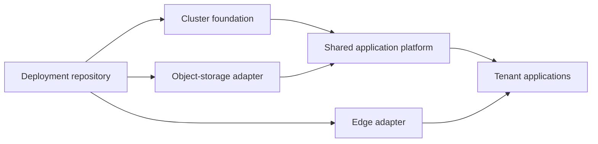

# Provider support and portability plan

Idle Infra should give application teams the same tenant boundaries, shared
services and operational view whichever provider an operator chooses. Provider
support means proving those properties on that provider, including recovery.

## Status

| Target | Status | What is available |
| --- | --- | --- |
| Infomaniak | Current reference implementation | Managed Kubernetes and OpenStack storage modules; deployment scaffold and staged bootstrap guide |
| Existing Kubernetes cluster | Planned | Most runtime components use Kubernetes, but the platform still creates OpenStack credentials; this is not a standalone supported path yet |
| Hetzner Cloud | Planned | Adapter design below; no provisioned or tested deployment yet |
| Other providers | Future | Add explicit adapters against the same platform contract |

The Infomaniak example has structural validation. Fresh project bootstrap still
needs end-to-end verification. A supported-provider label must describe the
versions and checks actually exercised, rather than imply universal compatibility.

## Separate infrastructure from the application platform

Use composition in deployment roots: a provider-specific foundation followed by
shared platform modules. Avoid distributing `if provider == ...` branches
through the shared resources.

| Layer | Owns | Supplies to the next layer |
| --- | --- | --- |
| Cluster foundation | Servers or managed cluster, networking, API access, CCM/CSI, policy-enforcing CNI and provider chart overrides | Ready Kubernetes API, explicit post-DNAT API destination for network policy, StorageClass, node placement and capabilities |
| Object-storage adapter | Buckets, credentials, access policies, endpoint/region and optional usage source | Separate bindings for app broker, backups and telemetry; optional exact-counter capability |
| Shared platform | PostgreSQL, Zitadel, tenant boundaries, broker, console and telemetry workloads | Consistent application-facing services and operational contracts |
| Edge adapter | DNS, tunnel or direct ingress integration | Published hostnames and certificates |
| Deployment root | Selects adapters, pins versions, owns state and credentials | A complete, reviewable installation |

Provider boundaries also include state-bucket bootstrap and backend behavior.
The backend is a deployment choice, not necessarily the same object store used
by applications. Versioning and state encryption do not supply writer locking.

### Where the current code needs work

- `terraform/modules/cluster` creates Infomaniak-managed Kubernetes resources.
- `terraform/modules/platform` creates broker and console EC2 credentials and a
  Swift application credential. Move those out before calling this portable.
- `terraform/modules/object-storage` creates Swift containers and injects their
  credentials. Separate provisioning from the Kubernetes-facing binding.
- `terraform/modules/observability` combines its runtime with a Swift bucket and
  credential. Split those responsibilities along the same boundary.
- `terraform/bootstrap` provisions Swift state storage; supply separate bootstrap
  examples for other backends.
- Shared chart defaults include Cinder storage and an Infomaniak kubelet TLS
  exception. Keep cloud-specific settings in provider overlays and validate the
  target's TLS behavior explicitly.
- The console's exact bucket counters use Swift container metadata in
  `docker/infra-console/internal/source/objectstore.go`. Expose usage as an
  optional capability; unavailable counters must remain visibly unavailable.

These extractions need state-address migrations in existing deployments.
Preserve existing addresses where possible, and verify a no-change plan on the
reference provider before moving on.

## First Hetzner implementation

Recommended first scope: **Hetzner Cloud VMs, one deliberately selected Kubernetes
bootstrap path, Hetzner Cloud volumes, S3 object storage and the existing
Cloudflare edge**. Keep managed Kubernetes and self-managed control-plane
lifecycles explicit rather than pretending they are interchangeable.

Before implementation, choose a Kubernetes distribution/bootstrap tool, HA
control-plane topology, API access path, CNI, upgrade/restore ownership and node
architecture. K3s and Talos are candidates for that decision, not supported
options promised by this framework. Start with amd64 until every runtime image
and dependency is verified for an additional architecture.

Hetzner publishes a [cloud controller manager](https://github.com/hetznercloud/hcloud-cloud-controller-manager)
and [CSI driver](https://github.com/hetznercloud/csi-driver). Treat their
installation, configuration and version compatibility as foundation concerns.
PostgreSQL needs durable volumes with deliberate reclaim policy, expansion and
a proved restore path. A volume's availability must not be described as database
high availability.

Application ingress can keep Cloudflare Tunnel → ClusterIP ingress-nginx. A
Hetzner load balancer is a separate choice for API availability or a future
direct-origin ingress path; it is not required simply to retain this tunnel path.

### Object storage is a behavior contract

Do not replace an S3 hostname and assume equivalent behavior. Hetzner documents
[project-wide keys with bucket-policy restrictions available](https://docs.hetzner.com/storage/object-storage/faq/s3-credentials/)
and [S3 compatibility exceptions](https://docs.hetzner.com/storage/object-storage/supported-actions/).
Use cloud credential scoping as an additional boundary and retain broker
policy enforcement. Verify the actual denied cross-bucket and cross-tenant
requests with the intended credentials.

The documented exceptions include inventory/metrics, cross-bucket copies and
conditional PUT/DELETE on versioned buckets. Test presigning, signed headers,
staging-to-final copy within a bucket, checksums, overwrite protection, multipart
transfers, governed deletion and DuckLake cleanup against the chosen bucket
configuration. Do not promise exact storage counters until a usage adapter has
been implemented and verified.

## Delivery sequence and acceptance

1. Extract storage provisioning/credentials and provider chart overlays. Keep the
   Infomaniak deployment behavior and verify its no-change plan and isolation
   checks after migration.
2. Add an existing-cluster composition with explicit StorageClass, network
   destinations and externally supplied S3 bindings. Prove it on a disposable
   cluster without cloud credentials in the shared platform.
3. Add a Hetzner foundation and example. Bootstrap in a disposable project with
   encrypted state and one serialized writer. Record pinned versions and cost
   expectations before provisioning.
4. Run the same tenant allow/deny matrix: RBAC, network policy, schema grants,
   ingress ownership, storage authority and credential boundaries. Verify console
   unavailable states as well as working sources.
5. Exercise PostgreSQL backup/restore, node drain and replacement, volume
   retention/expansion, control-plane recovery, upgrades and safe teardown. Check
   for leaked volumes, buckets and other billable resources afterwards.
6. Publish the tested versions, bootstrap steps, limitations and recovery
   procedure; only then mark Hetzner supported.

The first useful milestone is a portable platform on an existing cluster. It
reduces provider work to a foundation and storage integration, while keeping
operator responsibilities visible.
